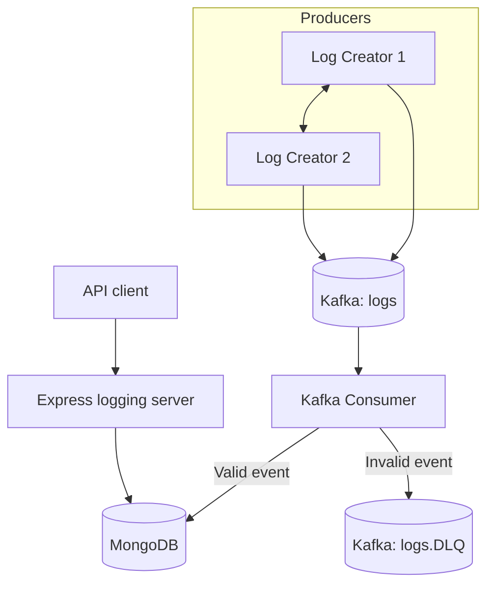

# Architecture

## Overview

Log creator services publish JSON events to Kafka topic `logs`. A Kafka consumer reads those events, validates them, and saves valid records to MongoDB. Empty, malformed, or invalid events are sent to `logs.DLQ`. The Express server remains available for health checks and querying persisted logs.



## Responsibilities

- **Log creators:** simulate services and generate events.
- **Kafka `logs`:** buffers log events for asynchronous processing.
- **Consumer:** parses and validates records, persists valid events, and sends invalid events to the DLQ.
- **Kafka `logs.DLQ`:** retains failed/invalid records for inspection or later recovery.
- **MongoDB:** stores log records in the `logs` collection.
- **Express API:** exposes health and log retrieval endpoints.

## Event shape

Example only; the code is authoritative:

```json
{
  "message": "Received current_time request",
  "level": "DEBUG",
  "machine_id": "log-creator-1",
  "request_id": "example-request-id",
  "timestamp": "2026-10-18T10:00:00.000Z"
}
```

The consumer accepts `DEBUG`, `INFO`, `WARN`, and `ERROR`, and validates the message, machine ID, request ID, and timestamp.

## Why Kafka if the logging server still exists?

The two paths have different purposes:

- **Ingestion:** log creators -> Kafka -> consumer -> MongoDB.
- **Query:** API client -> Express logging server -> MongoDB.

Kafka decouples producers from database writes and buffers events. The Express server remains because clients need an HTTP interface to retrieve stored logs and check health.

## Reliability considerations

- Producer acknowledgement confirms Kafka acceptance under the configured policy; it does not prove MongoDB persistence.
- A single broker and replication factor `1` do not provide broker redundancy.
- A crash between a MongoDB insert and offset commit may lead to duplicate processing.
- DLQ publishing should complete before an invalid event is considered handled.
- A DLQ topic is not itself a retry/replay workflow.
- Do not claim exactly-once end-to-end processing unless it is implemented and tested.

Consumer parallelism within a group is constrained by topic partition count. Scaling consumers, increasing partitions, database indexes, retry policy, and idempotency should be evaluated deliberately.
